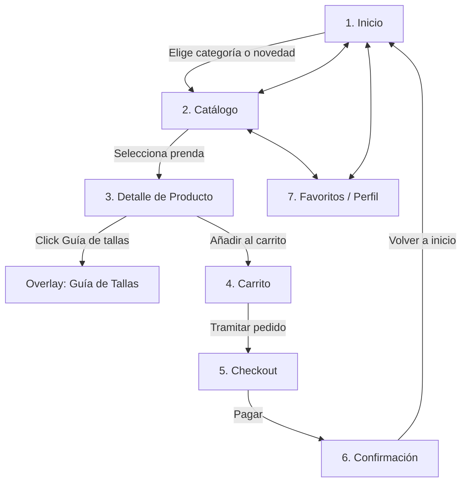

# Documentación de la interfaz — <nombre de tu tienda>

## 1. Justificación del diseño
### 1.1 Importancia del diseño centrado en el usuario

Enfocamos este proyecto en una tienda de ropa infantil donde el público objetivo no son los niños, sino los adultos ocupados que compren estos artículos con el objetivo de regalo. Para ello, la interfaz debe ser sencilla y dirigida a los adultos con poco tiempo que necesiten comprar sin tener mucha idea sobre 

### 1.2 Objetivos y metas del proyecto      (mín. 3 objetivos medibles)

1. **Reducción del tiempo de compra:** permitiremos que el usuario pueda cumplir el procedimiento en menos de 2 minutos, desde la búsqueda del producto hasta la finalización de la compra.
2. **Minimización de devoluciones por error de talla:** minimizar la probabilidad de que los usuarios tengan que devolver los regalos que hacen debido a que las tallas son erróneas haciendo que fácilmente puedan consultar una guía de tallas accesible para todos los usuarios.
3. **Optimización de la tasa de finalización del checkout:** conseguir una alta tasa de finalización de compra, haciendo que los usuarios no se queden a mitad camino de una compra.

### 1.3 Beneficios esperados                 (para el usuario y para el negocio)

* **Para el usuario:** agilidad en la navegación con una sola mano, certeza inmediata en la selección de la talla adecuada mediante guías visuales contextuales y un proceso de compra claro sin pasos innecesarios.
* **Para el negocio:** incremento en la conversión directa desde móvil, fidelización del cliente recurrente mediante confianza en el catálogo y reducción sustancial de los costes operativos vinculados a cambios y devoluciones de prendas.

---

## 2. Investigación y análisis de usuarios
### 2.1 Datos demográficos y segmentación

El público objetivo se divide en dos segmentos primarios:
* **Padres y madres jóvenes (26 a 42 años):** nativos digitales con agendas saturadas. Realizan compras funcionales de reposición rápida desde el móvil mientras compaginan trabajo y cuidados de los niños.
* **Familiares sénior y compradores de regalos (50 a 70 años):** compradores ocasionales que buscan prendas para fechas especiales (nacimientos, cumpleaños, temporadas); suelen dudar de la equivalencia entre meses/años y centímetros de los niños, demandando orientación explícita y procesos de pago asistidos y legibles.

### 2.2 Personas                          

#### Persona 1: una madre sin tiempo
* **Contexto:** madre de 34 años. Consultora de marketing y madre de un bebé de 9 meses y una niña de 4 años. Navega casi siempre desde el móvil mientras tiene tiempo libre.
* **Objetivos:** Comprar ropa básica para el cambio de temporada de sus hijos de manera rápida, segura y sin tener que comparar tablas externas de medidas.
* **Frustraciones:** Formularios de compra largos con campos innecesarios, selectores de talla diminutos que provocan toques erróneos y descripciones de producto ambiguas sobre la composición textil.

#### Persona 2: un abuelo detallista
* **Contexto:** 63 años. Jubilado y abuelo reciente. Quiere regalar conjuntos de ropa a sus nietos por sus cumpleaños, pero desconoce la equivalencia entre la edad del niño y la talla real de confección.
* **Objetivos:** Encontrar regalos atractivos guiándose por la edad del niño en meses/años y recibir confirmación inmediata de que el pedido ha quedado registrado sin confusiones.
* **Frustraciones:** Textos con poco contraste o tipografía demasiado pequeña, pérdida del progreso de compra al equivocarse rellenando un campo y procesos de devolución poco transparentes.

### 2.3 Análisis de la competencia           (tabla con mín. 3 apps)

| Competidor | Qué hacen bien | Qué hacen mal | Qué nos llevamos para el proyecto |
| :--- | :--- | :--- | :--- |
| **Zara Kids** | Fotografía editorial inmersiva y navegación por categorías visualmente limpia. | Selector de tallas confuso; la información de medidas reales queda oculta tras varios clics y el botón de añadir al carrito es poco visible con una mano. | Mantener tarjetas de producto limpias pero con llamada a la acción (CTA) y selectores de talla destacados a primer nivel. |
| **H&M Niños** | Filtrado ágil por edad y tipo de prenda mediante *filter chips* bien jerarquizados. | El proceso de checkout está sobrecargado de opciones de fidelización y pasos intermedios que ralentizan el cierre de la compra. | Adoptar el uso de chips de filtro directos accesibles en la parte superior del catálogo y recortar el checkout a una pantalla ágil. |
| **Mayoral** | Filtrado ágil por edad y tipo de prenda mediante *filter chips* bien jerarquizados. | El proceso de checkout está sobrecargado de opciones de fidelización y pasos intermedios que ralentizan el cierre de la compra. | Adoptar el uso de chips de filtro directos accesibles en la parte superior del catálogo y recortar el checkout a una pantalla ágil. |

### 2.4 Insights y hallazgos clave           (mín. 4, cada uno con su decisión de diseño)

1. **Duda crítica con las equivalencias de tallas:** Los usuarios compradores de regalos no recuerdan medidas en centímetros y temen equivocarse.  
   * **Decisión de diseño:** Implementar un botón directo «Guía de tallas» junto al selector del producto que despliega un *bottom sheet* con equivalencias rápidas (edad, altura y peso) sin sacarlo del flujo de compra.
2. **Uso preferente a una sola mano en movimiento:** La mayoría de compras se efectúan sosteniendo el terminal con una mano mientras se atiende otra actividad.  
   * **Decisión de diseño:** Disponer los botones principales de acción (*sticky CTA* para añadir al carrito y tramitar compra) en el tercio inferior de la pantalla, garantizando un área de contacto mínima de 48×48 dp.
3. **Miedo a la eliminación accidental de artículos:** Al operar con rapidez, tocar iconos de borrado por error genera fricción si no hay vuelta atrás sencilla.  
   * **Decisión de diseño:** Al eliminar un ítem del carrito, el sistema muestra un *snackbar* emergente con la acción «Deshacer» activa durante unos segundos.
4. **Fatiga ante errores en formularios de pago:** Los campos que no alertan en tiempo real provocan que el usuario abandone antes de revisar todo el formulario.  
   * **Decisión de diseño:** Utilizar campos de texto (*text fields*) M3 con validación reactiva y mensajes de ayuda/error explícitos debajo de cada campo comprometido.

---

## 3. Diseño de la interfaz
### 3.1 Mapa de navegación                   (bloque ```mermaid)



### 3.2 Wireframes

- Subidos en la carpeta wireframe.

### 3.3 Guía de estilo Material Design 3

A partir del color semilla `# `, se ha generado el sistema cromático semántico en esquemas claro y oscuro mediante el plugin Material Theme Builder. Se ha justificado la elección de esta tonalidad azul brillante por su estímulo positivo y atractivo visual en moda infantil, adaptándose algorítmicamente para garantizar la accesibilidad y la legibilidad en pantalla.

#### Verificación de contraste (WCAG AA)
Todos los pares de color de interacción cumplen o superan el criterio de conformidad WCAG 2.1 AA (ratio mínimo de 4.5:1 para texto normal):

* **Primary / onPrimary (Claro):** `#005FAF` sobre `#FFFFFF` → Ratio **5.14:1** (Cumple AA).
* **Primary Container / onPrimaryContainer (Claro):** `#D4E3FF` sobre `#001C3A` → Ratio **14.12:1** (Cumple AAA).
* **Surface / onSurface (Claro):** `#FDFBFF` sobre `#1A1C1E` → Ratio **16.10:1** (Cumple AAA).
* **Error / onError (Claro):** `#BA1A1A` sobre `#FFFFFF` → Ratio **5.74:1** (Cumple AA).
* **Primary / onPrimary (Oscuro):** `#A5C8FF` sobre `#00315F` → Ratio **8.35:1** (Cumple AAA).
* **Surface / onSurface (Oscuro):** `#1A1C1E` sobre `#E2E2E6` → Ratio **13.04:1** (Cumple AAA).

#### Escala tipográfica
Se implementa la tipografía de sistema **Roboto** en 5 roles jerárquicos de Material Design 3:
* `headlineSmall`: 24 px / interlineado 32 px / Regular (400) — Encabezados y títulos principales.
* `titleLarge`: 22 px / interlineado 28 px / Regular (400) — Títulos en la Top App Bar.
* `titleMedium`: 16 px / interlineado 24 px / Medium (500) — Nombres de artículos en tarjetas.
* `bodyLarge`: 16 px / interlineado 24 px / Regular (400) — Descripciones de prendas y textos informativos.
* `labelLarge`: 14 px / interlineado 20 px / Medium (500) — Etiquetas de botones, chips y navegación.

#### Retícula, espaciado y áreas táctiles
* **Retícula:** Configuración móvil de 4 columnas, márgenes laterales de 16 dp y medianil de 16 dp.
* **Sistema de espaciado:** Múltiplos basados en incrementos de 8 dp (8, 16, 24, 32 dp).
* **Área táctil mínima:** Todos los componentes interactivos cuentan con un área de contacto mínima de **48×48 dp** para facilitar la pulsación a una sola mano.

### 3.4 Prototipo de alta fidelidad

---

## 4. Validación y pruebas
### 4.1 Metodología                          (mín. 3 tareas y métricas)
### 4.2 Resultados                           (tabla con mín. 2 participantes)
### 4.3 Iteraciones y mejoras               (antes/después)

--

## 5. Entrega y documentación final
### 5.1 Justificación del diseño propuesto
### 5.2 Recomendaciones y pasos a seguir

---

## 6. Referencias bibliográficas              (mín. 4, APA 7, exportadas desde Zotero)

Palabra del día: 29